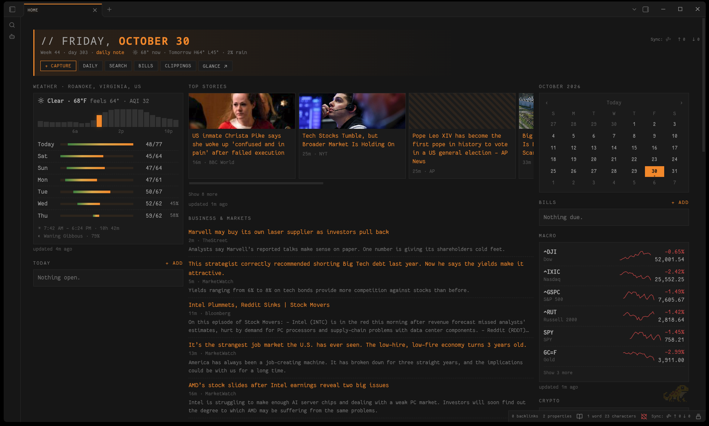

# Homewire

A Glance-style homepage for Obsidian: a date and weather banner, one-click buttons, live news, markets and weather, a **Today** box fed by your daily notes, a simple **bill tracker**, and a month calendar, all in one note.



It looks best with the [Salamander](https://github.com/jasonpersinger/obsidian-salamander) theme and follows its palette presets, but it works with any theme.

## Getting started

1. Install and enable **Homewire**.
2. Run the command **Homewire: Create homepage**. It creates three notes (it never overwrites existing ones):
   - `Home.md`: the page itself (just a `homewire` code block)
   - `Home Config.md`: feeds, tickers, weather location and buttons
   - `Bills.md`: your bills
3. Set your location in `Home Config.md` (`weather.place`, or `lat` and `lon`).
4. Optional: to open the page on startup, install the [Homepage](https://github.com/mirnovov/obsidian-homepage) plugin, point it at `Home.md`, and choose **Reading view**.

The three note paths can be changed in the plugin settings.

## Config reference

`Home Config.md` holds one ```` ```yaml ```` block. The page updates when you save it. If the YAML is invalid, the last good config stays in use and the error appears at the top of the page.

```yaml
banner:
  clock: true                # large clock (default true)
  marketSession: true        # US market pre-market / open / after hours / closed, NYSE holidays included (default true)
  fearGreed: true            # CNN Fear & Greed index in the banner (default false)

clippings:                   # newest notes from Obsidian Web Clipper (default shown)
  folder: Clippings          # Web Clipper's default folder
  limit: 5
# clippings: false           # hides the panel

weather:
  units: imperial            # imperial | metric (default imperial)
  place: Paris, France       # looked up once via Open-Meteo geocoding
  # lat: 48.85               # or exact coordinates (both required)
  # lon: 2.35

buttons:                     # each needs a label and exactly one action
  - label: "+ Capture"
    primary: true            # optional: accent styling
    icon: plus               # optional: any Lucide icon id
    action: { builtin: add-today }   # add-today | add-bill | open-daily
  - label: Search
    action: { command: "global-search:open" }   # any command id
  - label: Inbox
    action: { file: "Inbox.md" }                # open a note
  - label: Glance
    action: { url: "https://example.com" }      # open a web page (http/https only)

news:
  - title: Top Stories
    style: cards             # cards | list (default list)
    limit: 12                # items shown in the group (default 14)
    collapseAfter: 6         # rest hidden behind "Show more" (default 6)
    cacheMinutes: 15         # refresh interval (default 15)
    feeds:
      - { title: BBC World, url: "https://feeds.bbci.co.uk/news/world/rss.xml", limit: 6 }

markets:
  - title: Macro
    collapseAfter: 6         # default 6
    markets:
      - { symbol: "^GSPC", name: S&P 500 }   # Yahoo Finance symbols
      - { symbol: BTC-USD, name: Bitcoin }
```

## Bills

One bill per line in `Bills.md`. The amount is optional:

```
- [ ] Electric · $142.18 · due 2026-11-03
- [ ] Rent · due 2026-11-01
```

The **Bills** panel lists unpaid bills by due date: red when late, highlighted when due within 3 days. Tick a bill (on the page or in the note) to mark it paid. It leaves the panel but stays in the note as a record. The **Add bill** command and button write the line for you.

## Recent clippings

Lists the newest notes in your clippings folder (Obsidian Web Clipper saves to `Clippings` by default), newest first by the clip's `created` date. Click a title to open the note, or ↗ to open the original page.

## Today

The **Today** box shows unchecked `- [ ]` items from today's daily note, plus any still open from the previous 7 days (dimmed, with their date). Ticking one checks it off in its note. **+ add** (or the **Add task to today** command) appends a task to today's note, creating it if needed. This uses the core **Daily notes** plugin's folder, date format and template.

## Network use

Homewire fetches data over the network. It contacts only:

- **The RSS/Atom feeds you list** in your config, and the image hosts those feeds point to (for card thumbnails).
- **`query1.finance.yahoo.com`**: market prices for the symbols you list.
- **`api.open-meteo.com`** and **`air-quality-api.open-meteo.com`**: forecast and air quality for your location.
- **`geocoding-api.open-meteo.com`**: once, to turn `weather.place` into coordinates.
- **`production.dataviz.cnn.io`**: only if you turn on `banner.fearGreed`. This is CNN's unofficial Fear & Greed endpoint. It only answers browser-like requests, so Homewire sends a browser User-Agent and a CNN referer for this one request. It may change or stop working without notice; the gauge then shows "unavailable".

No account, API key or telemetry is involved, and nothing about you or your vault is sent. Results are cached on each device (not in synced files) and refreshed only while the homepage is open.

Feed content is treated as untrusted: it is shown as plain text only, and links and images are used only when they are ordinary `http(s)` URLs.

## Development

```bash
npm install
npm run dev     # watch build
npm test        # unit tests (vitest)
npm run lint    # eslint-plugin-obsidianmd
npm run build   # production build → main.js
```

## License

[MIT](LICENSE)
